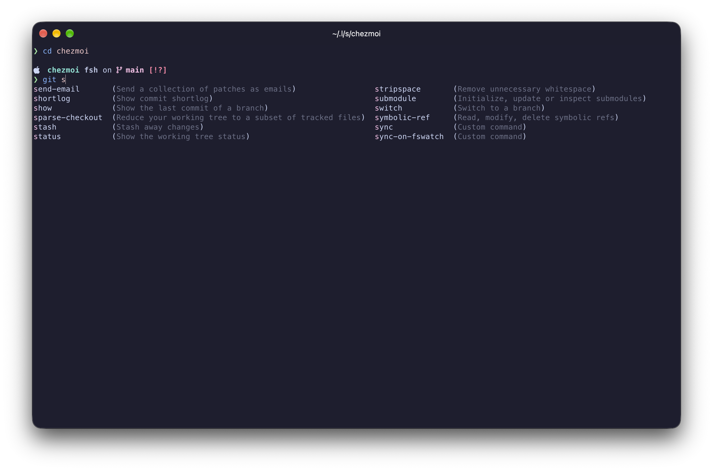

# dotfiles


Shell and tool configurations managed with [chezmoi](https://www.chezmoi.io/).



## Install

Dotfiles and the [recommended tools](docs/tools.md), on Linux or macOS:

```sh
sh -c "$(curl --proto '=https' --tlsv1.2 -fsSL https://get.chezmoi.io/lb)" -- init --apply --promptBool tools=true ajholzbach
```

See [docs/install.md](docs/install.md) for the dotfiles-only install, Windows, and other install options.

## What this repository does

- Applies configuration for Bash, zsh, Fish, Xonsh, and PowerShell
- Installs the latest stable [Starship](https://starship.rs/) when it is missing
- Installs MesloLGS Nerd Font on Linux and macOS
- Installs [Antidote](https://github.com/mattmc3/antidote) on Linux and macOS when zsh is present
- On macOS, the tools install gets chezmoi, Starship, Antidote, and the font from Homebrew
- Uses the [Catppuccin Mocha](https://catppuccin.com/palette/) theme wherever possible
- Gives Claude Code and Codex the same agent instructions and installs RTK hooks when RTK is present
- Creates a restore point before changing managed files

## Managed configuration

| Program | Configuration |
| --- | --- |
| Bash | Shared `.profile`, local environment, and guarded tool integrations |
| zsh | Completion, history, lazy Conda and NVM, and Antidote plugins |
| Fish | Lazy zoxide, fzf, and Conda, the `wget`, `tarnow`, `untar`, and `psmem` helpers, extra completions, the Catppuccin Mocha theme, and the Fisher plugin list |
| Xonsh | Guarded integrations, lazy Conda, and Git aliases |
| PowerShell | One shared profile for PowerShell 7 and Windows PowerShell |
| [eza](https://eza.rocks/) | `ls`, `ll`, `la`, and `lt` aliases with icons and directory grouping |
| [bat](https://github.com/sharkdp/bat) | `cat` alias and Catppuccin theme |
| [zoxide](https://github.com/ajeetdsouza/zoxide), [fzf](https://github.com/junegunn/fzf), [mise](https://mise.jdx.dev/) | Shell integration |
| [Ghostty](https://ghostty.org/), [Zed](https://zed.dev/) | Catppuccin Mocha and MesloLGS Nerd Font |
| Vim, tmux | Configuration |
| btop | Catppuccin Mocha theme |
| Other tools | Small configuration changes, such as the Catppuccin Mocha theme |

Each integration activates only when its program is installed.

## Fish plugins

[Fisher](https://github.com/jorgebucaran/fisher) installs these plugins from [`fish_plugins`](home/dot_config/fish/fish_plugins):

- [ajholzbach/fish-git](https://github.com/ajholzbach/fish-git) provides lazy-loaded Git aliases.
- [ajholzbach/fish-kubectl](https://github.com/ajholzbach/fish-kubectl) provides lazy-loaded kubectl aliases and completions.

## Local overrides

Keep machine-specific values in these untracked files:

- `~/.config/local-env.sh` for Bash and zsh
- `~/.config/local-env.fish` for Fish
- `~/.config/local-env.ps1` for PowerShell

Apply keeps the blocks that other tools add to `~/.bash_profile` between `# >>> name >>>` and `# <<< name <<<` lines.

## Repository layout

- `home/` contains the files applied to `$HOME`
- `home/.chezmoiscripts/` contains setup and restore-point scripts
- `home/dot_config/mise/conf.d/10-dotfiles-tools.toml` lists the recommended tools
- `docs/` contains the install, tools, and uninstall guides
- `tests/` contains the Docker test suites, which GitHub Actions runs on each push
- `uninstall.sh` and `uninstall.ps1` restore the pre-install state

## Docs

- [Install](docs/install.md)
- [Recommended tools](docs/tools.md)
- [Uninstall](docs/uninstall.md)
- [Testing](tests/README.md)
